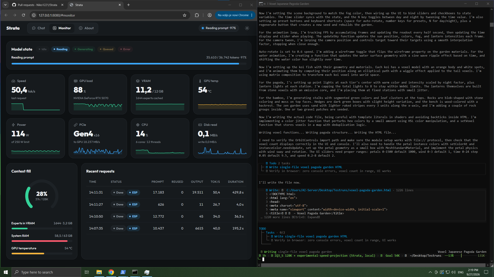
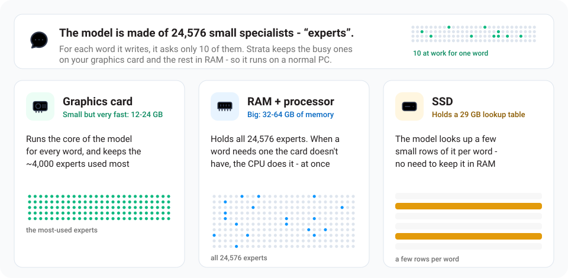

> [!NOTE]
> This is my fork of [Strata](https://github.com/Niko1221/Strata). The `unify` branch is the current one: upstream
> v0.1.44.1 with all of my `orca-port` work merged on top. `orca-port` is kept as it was, for reference.
> Upstream's own README starts [further down](#strata-upstream).

## What this fork is for

Upstream Strata assumes 64 GB of RAM. My box has 30 GB (Ryzen 9 9900X, DDR5-6200, RTX 4070 Super 12 GB, one NVMe
drive), and the IQ3_S experts alone are 50 GB. So most of this work is about running the model when it doesn't fit:
keeping the right experts in VRAM and RAM, reading the rest from disk fast enough, and hiding as much of that as
possible behind GPU work.

One rule for all of it: the output has to match the stock IQ3_S quant. No dropping experts, no requantizing cold ones
to save bandwidth. I tried a couple of lossy shortcuts along the way (dropping low-rank misses was worth +5 to +30%)
and threw them out because the quality hit wasn't worth it.

## Where it ended up

All numbers are from my box, sampling at temperature 1.0 on 20 held-out prompts (`hill/xb.py --big`). Greedy decoding
gives flattering numbers on this setup, so I only use it to check that outputs are identical.

| | decode tok/s | cold prefill tok/s | prefix hit, 65K context |
| --- | ---: | ---: | ---: |
| `orca-port` (Oct 16) | 43.2 | ~775 | 13.2K tok/s effective |
| `unify` | **48.4** | **1350-1450** | **18.8K tok/s effective** |

Both rows come from the same session, back to back. Decode on `orca-port` went from 24.5 to 43.5 tok/s over the last
two days of tuning before the merge (more on that below).

## How `unify` was put together

`orca-port` forked from upstream v0.1.8, and by v0.1.44.1 upstream had made big changes to the prompt
path, the arena and the server. Rebasing 40-odd commits across all that wasn't realistic, so I re-parented a snapshot of `orca-port` onto
v0.1.8 and did one three-way merge against v0.1.44.1, then fixed what didn't build. After that I ported my prefill and
pool work onto upstream's newer code instead of keeping my old versions of those files.

What changed on top of the merge:

- **Fused CPU expert pool.** Gate/up and down used to run as two phases with a barrier and a host-side quantize in
  between. Now each expert has its own ready stamp and the last gate/up worker quantizes H, so down starts as soon as
  its expert is ready. `STRATA_POOL_FUSE=0` gives the old behaviour.
- **Tiled prefill on upstream's prompt path.** Attention and MoE run in 2048-token tiles inside a 32K chunk
  (`STRATA_PF_TILE`), with per-tile q8_1 rows for the MMQ matmuls. Results are bitwise equal to running the chunk
  whole. This roughly doubled cold prefill.
- **Prompt cache fix.** Upstream always pinned the first checkpoint as the root, even when it was just a periodic one.
  With `--prompt-cache 2` that meant a long conversation lost its turn checkpoint and re-read everything after 32K.
  Fixing it is where the 13.2K to 18.8K jump on prefix hits comes from. `STRATA_CKPT_PIN_FIRST=1` restores upstream's
  behaviour.
- **O_DIRECT for the prompt stager** and parallel refill of lent arena slots.
- Telemetry: per-request pool stats (GB per window, GB/s, experts per call), a per-call trace
  (`STRATA_CALL_TRACE`, `hill/ctan.py`), prefill chunk budgets (`STRATA_PF_SIZES=1`).

## The `orca-port` work (all carried into `unify`)

### Expert tiering for a small-RAM box

- Three tiers: a VRAM slice, an mlocked hot set in RAM, and NVMe reads through a `pread` ring with a parked reader
  pool. The VRAM slice takes the next part of the routing profile after the hot tier, so the two never hold the same
  expert.
- Routing profiles built from real traces (`--dump-profile`, `--dump-counts`, `tools/make_profile_from_counts.py`).
- Fixed a 6.4x read amplification. The ring-full fallback was re-reading experts that were already in the hot tier;
  guarding that, plus reading whole blobs and dropping them from the page cache, took IQ3_XXS from 2.4 to 6.1 tok/s.
  Dispatch is now two-pass, so resident experts compute while disk reads are in flight.
- An adaptive LRU tier, later made exact-size (`STRATA_LRU_EXACT`) so slots match blob sizes instead of wasting
  space, with VRAM slots laid out per layer. Together with a 24 GiB LRU this moved decode from 24.5 to ~31 tok/s.
- `O_DIRECT` reads through a second fd with aligned bounce buffers. The page cache was costing ~39% CPU on reads.
  `STRATA_NO_ODIRECT=1` turns it off.
- Memory pressure handling: the tier is pinned with `cudaHostRegister` in 2 GiB slices, and the server unpins cold
  slices between requests when `MemAvailable` gets low, then adds them back when it recovers. Before this, a large
  tier plus KV could push the box into swap and kill `cublasCreate`.
- `STRATA_ADAPT3`: VRAM/RAM adapt swaps that trade places in-place instead of costing capacity.

### Decode

- **Async PLE reads.** On Linux, `DirectFile` was a plain synchronous `pread`, so the n-gram embedding rows were read
  one at a time while the GPU sat idle for ~6.6 ms per window. Moving them onto a thread pool: 30.2 to 34.1 tok/s.
- **Early issue** (`STRATA_EARLY`): a pinned thread starts the next call's disk reads before the current one finishes.
- **Radix sampler** for temperature sampling, which was costing ~2 ms per window.
- **Split verify windows fixed.** `--spec-split` was corrupting output (runs of `!!!!` after a few hundred tokens on
  about half the prompts, greedy included) because two groups shared one DMA flag. Every number I'd measured with it
  before that fix was wrong, which is why the bench tool now counts degenerate outputs.
- Verify graphs for every window size are prewarmed at startup, with a T=1 retry if a window runs out of memory late.

### Prefill

- Decoupled the prefill chunk from scratch VRAM using tiles, and allocate the buffers per run so decode is never
  starved for memory. Warm 11K prefill went from 50 to 694 tok/s on `orca-port`.
- Fixed an out-of-bounds write in the mixed tile buffer when chunk > tile (it showed up as degenerate `!!!` output),
  and moved the cuBLAS handle and scratch into `init` instead of creating them per prompt.

### Kernels

- AVX-512 multi-token `IQ4_NL` kernel, about 3x ggml's per-token path at 5 tokens. The first version had a sign bug
  (`vpsignb(g, g)` is `|g|`, not the sign), which a fuzz test caught after the model started repeating itself.
- `IQ4_XS` decode-once CPU kernel for Orca, fuzzed against ggml's AVX2 version.
- `native_moe` combine and the sampler: shared-memory weight broadcast, wide loads, unique-token counts cached
  (same output, much faster on long histories).

### Orca support

- `tools/make_native_head.py` and `tools/probe_gguf.py` stream the shards instead of loading tens of GB into RAM.
  `tools/repair_heretic_pack.py` can dequantize `IQ4_XS` and `IQ4_NL` to BF16.
- `strata-orca-iq4xs.json` is a working endpoint config.

### Server

- Over-budget `max_tokens` is clamped to the room left instead of returning a 400.
- Engine faults come back as a `finish_reason` (retryable or overflow) rather than a dropped connection.
- 300 s watchdog; requests wait for a restarting engine instead of failing; stale engine output can't leak into the
  next request.
- 61 contract tests in `serve/`.

## Things that didn't work

Written down so nobody (me included) tries them again: transparent huge pages for the tier, different prefetch
distances, router lookahead (52% recall, 21% precision, a net loss), ghost/LFU tier admission, per-layer LRU
allocation, speculative sampling of MTP drafts (better acceptance but each extra window row costs ~13.6 ms of fresh
experts), and rewriting the IQ4_NL kernel on the default path. The CPU pool is already DRAM-bound at ~55-58 GB/s.

Where the time goes now: about 550 MB of expert reads from RAM per accepted token, ~27% of host time waiting on the
disk ring, and the SSD tops out around 135K random 4K IOPS. On the GPU side, kernels plus ~5 ms of host work per window
would cap decode somewhere around 90-100 tok/s even with free CPU.

## Running it

The config I use is `hill/cfg-unify-best.json` (paths are for my machine). Build with `build-engine.sh`; the engine
needs `cap_ipc_lock` so it can mlock the tier, and the script asks for sudo to set it. `hill/srv-uni.sh CFG PORT`
starts the server. Bench tools are in `hill/`: `xb.py` (decode), `pb.py` (prefill), `dlt.py` (prefix hits),
`pfcheck.py` and `gcmp.py` for checking that a change doesn't alter the output. Expect hardcoded paths in there.

---

<a id="strata-upstream"></a>
---
<h1 align="center">Strata</h1>

**English** · [简体中文](README.zh-CN.md) · [日本語](README.ja.md) · [Deutsch](README.de.md) · [Français](README.fr.md) · [Español](README.es.md) · [Português](README.pt-BR.md)

<p align="center"><b>Run a 125-billion-parameter AI model on your own gaming PC</b><br>
NVIDIA or AMD graphics card (12 GB or more) · Windows or Linux · free and open source</p>

<p align="center"><a href="https://github.com/Niko1221/Strata/releases/download/v0.1.10/Pagoda.mp4"></a><br>
<sub>A voxel pagoda garden, 1 shot prompt running on an RTX 5070 with Strata (IQ3_S, 128K context) ·
<a href="https://github.com/Niko1221/Strata/releases/download/v0.1.10/Pagoda.mp4">full video (49 s)</a></sub></p>

Strata runs **[Qwen3.8-Flash-Next](https://huggingface.co/Qwen/Qwen3.8-Flash-Next)** on a normal PC. This is a
large, smart AI model that usually needs a server. It chats, writes code, reads pictures and works with your apps
and coding agents. Nothing leaves your PC.

## How fast is it?

We measured it on two ordinary gaming PCs. A token is about ¾ of a word.

- **Writes answers:** how fast the reply appears in a short chat. 60 tokens per second is faster than you can read.
- **Reads your prompt:** how fast it takes in what you send (here a 32K-token document, code or chat history).

<table>
<tr><th>NVIDIA: RTX 5070 (12 GB), Ryzen 5 7600, 64 GB RAM</th><th>AMD: RX 9070 XT (16 GB), Ryzen 9 3900X, 47 GB RAM</th></tr>
<tr><td>

| Size | Writes answers | Reads your prompt |
| --- | ---: | ---: |
| **Q2_0** | 94 tokens/s | 2,650 tokens/s |
| **IQ2_XS** | 79 tokens/s | 2,090 tokens/s |
| **IQ3_XXS** | 62 tokens/s | 1,750 tokens/s |
| **IQ3_S** | 53 tokens/s | 1,620 tokens/s |
| **Coder** | 55 tokens/s | 2,180 tokens/s |

</td><td>

| Size | Writes answers | Reads your prompt |
| --- | ---: | ---: |
| **Q2_0** | 60 tokens/s | 1,160 tokens/s |
| **IQ2_XS** | 52 tokens/s | 1,110 tokens/s |
| **Coder** | 44 tokens/s | 1,420 tokens/s |

</td></tr>
</table>

NVIDIA: Q2_0 with engine 0.1.36, the other rows with 0.1.26 (4K answers, 32K prompts). The full tables are in
[DETAILS.md](docs/DETAILS.md#speed-measured). A card with more VRAM is faster: an RTX 3090 (24 GB) should write
about 100-140 tokens per second. Long chats and other cards: [speed of each model](docs/MODELS.md#how-fast-is-each-size),
[community results](docs/COMMUNITY_BENCHMARKS.md).

<p align="center"><a href="https://buymeacoffee.com/strataengine"></a><br>
<sub>Strata is free. If it runs well on your PC, a coffee keeps the work on it going.</sub></p>

## What you need

| | |
| --- | --- |
| **Graphics card** | **NVIDIA** GeForce RTX 20, 30, 40 or 50 series, or **AMD** Radeon RX 7900 XT / XTX, RX 7800 XT / 7700 XT, RX 9060 XT, RX 9070 / 9070 XT, Radeon AI PRO R9700 or RX 6800 / 6900 series. It needs **12 GB of VRAM or more**. |
| **RAM** | 32 GB or more. Your RAM decides [which model](#which-model-should-i-pick) fits. 64 GB runs every size. |
| **Disk** | About 80 GB free. Use an SSD if you can: the first start is much faster. |
| **System** | Windows 10 / 11 or Linux, and a current graphics driver from NVIDIA or AMD. |

The installer sets up everything else. Two or three cards can share the model ([multi-GPU](docs/MULTI_GPU.md)).

Experimental, written and tested by community members on their own machines:

- **Older graphics cards** (Tesla P40 / V100, GTX 10, Radeon VII / MI50, RX 6700 XT, RX 5500 XT): [Older GPUs](docs/OLDER_GPUS.md).
- **Intel Arc**, built from source on Linux: [Intel Arc](docs/INTEL_ARC.md).
- **Apple Silicon Macs (M1 to M5)**, built from source by `./setup.sh` (the Metal engine): [Mac](docs/MAC.md).
- **AMD Ryzen AI Max (Strix Halo)**, built from source on Linux: [Strix Halo](docs/STRIX_HALO.md).
- **Older processors without AVX2**: they work, but slowly. [Older CPUs](docs/INSTALL.md#older-cpus-experimental).

The full list: [docs/INSTALL.md](docs/INSTALL.md#what-you-need).

## Install

### Let your AI set it up

Do you use an AI coding assistant (Claude Code, Cursor, Codex, GitHub Copilot, ...)? Paste this into it:

```text
Set up Strata on this PC for me: https://github.com/Niko1221/Strata - follow docs/AI_SETUP.md in that repository.
```

It checks your graphics card, RAM and disk and picks the model that fits. Then it installs and starts it and tells
you how to connect your apps. AI tools can also install, start and stop Strata through its
[MCP server](docs/MCP_SERVER.md).

### Or do it yourself

[Download Strata](https://github.com/Niko1221/Strata/archive/refs/heads/main.zip) and unzip it (or `git clone` it).
**Windows:** double-click **`START-HERE.bat`**. **Linux:** run **`./setup.sh`** in the Strata folder.

**Mac (Apple Silicon, M1 to M5, macOS 15 or newer):** install Apple's Command Line Tools once
(`xcode-select --install` in Terminal; Xcode itself is not needed). Then open Terminal in the Strata folder and run
**`./setup.sh`**. It builds the Mac engine on your Mac (about 7 minutes), asks the same questions, downloads the model
and starts it. Next time, `./setup.sh` starts it right away. Which size fits your Mac and how fast it is:
[docs/MAC.md](docs/MAC.md).

The steps are the same for NVIDIA and AMD. The installer finds your card and sets up the right engine for it. It
asks you a few questions:

- which model and which size,
- how much context (how much text the model keeps in mind),
- whether it should read pictures.

Press Enter each time for the recommended answer. Then it downloads the model (about 70 GB) and starts it. If the
download stops, run it again: it continues where it left off. Your browser opens the Strata app at
`http://127.0.0.1:8080`.

> **While the model starts, your PC can be slow or stop responding for 1-3 minutes** (longest the first time).
> Strata loads 35-55 GB into your RAM and locks part of it for the graphics card. This is normal. Wait, and don't
> close the window. The window shows what Strata is doing.

**Next time**, run `START-HERE.bat` (or `./setup.sh`) again. It starts right away and downloads nothing twice. Close
its window to stop the model. `UPDATE.bat` (`./update.sh`) updates Strata without starting it. Updating, Docker,
several cards, where the files go and every option: [docs/INSTALL.md](docs/INSTALL.md).

**Is it fast on your PC?** Run `BENCH.bat` (`./bench.sh`): about 5-10 minutes, it measures chat, 4K/16K prompts and an agent-style session with your own settings and writes a report to share ([how](docs/COMMUNITY_BENCHMARKS.md#run-the-benchmark)).

## Which model should I pick?

The installer recommends one for your RAM. The same model comes in several sizes, compressed more or less. Smaller
sizes are faster. Larger sizes are a bit smarter.

| Your RAM | Take | Why |
| --- | --- | --- |
| **32 GB** | **Coder** | it fits 32 GB, and it is made for code (with a 24 GB card, Q2_0 and IQ2_XS run too) |
| **48 GB** | **IQ2_XS** (or Q2_0, the fastest) | the larger sizes do not fit |
| **64 GB** | **IQ2_XS** (recommended), or IQ3_XXS / IQ3_S | every size fits; IQ3_S is the best and the slowest |
| **96 GB or more** | **IQ3_S**, or Unsloth's UD-IQ4_XS (~4-bit) | room for the largest sizes with everything else open |

- **[Coder](docs/MODELS.md#coder):** a coding version with half of the experts removed. It reaches 91% of the full
  model's SWE-bench Verified score (measured by its authors) and fits 32 GB of RAM. It is weaker outside code,
  including Chinese and other CJK text (#438). For those, take Q2_0, IQ2_XS or IQ3_S, which keep every expert.
- **[Swift 1.5](docs/MODELS.md#swift-15):** a fine-tune that thinks for a much shorter time before it answers. You
  get the answer sooner, at about the same quality.
- **[Unsloth UD-IQ4_XS](docs/MODELS.md#unsloth-ud-iq4_xs):** Unsloth's ~4-bit version, between IQ3_S and
  UD-Q4_K_XL in quality. A 94 GB download. With less than ~80 GB of RAM, Strata reads part of it from the SSD
  while it answers, so it is slower there (an NVMe SSD helps).
- **[Unsloth UD-Q4_K_XL, UD-Q5_K_XL, UD-Q6_K_XL and Q8_0](docs/MODELS.md#unsloths-files-ud-iq4_xs-to-q8_0):**
  4- to 8-bit, closer to the full model (93-95% the same next token as Q8_0). Fast where every expert fits in RAM
  (~88 GB for UD-Q4_K_XL up to ~136 GB for Q8_0); with less RAM Strata reads part of them from the SSD while it
  answers, which is much slower (7-8.5 tokens/s for UD-Q4_K_XL on a 64 GB PC).
- **[OrcaRouter's Uncensored IQ3_XXS](docs/MODELS.md#orcarouter-uncensored-iq3_xxs):** you set it up by hand. It is
  not in the installer's menu.

Sizes, downloads and what fits where: [docs/MODELS.md](docs/MODELS.md). To add another model later, run
`SETUP.bat` (Linux: `./setup.sh --setup`).

## Using it

<p align="center"><br>
<sub>The Strata app's <b>Monitor</b> (left) while a coding agent writes the pagoda garden from the video (right)</sub></p>

- **In the browser:** open `http://127.0.0.1:8080`. It has **Chat**, a live **Monitor** of the model and your
  GPU/CPU/RAM, and **About** with the settings and addresses.
- **Your apps and coding agents:** add an "OpenAI-compatible" provider with the base URL
  **`http://127.0.0.1:8080/v1`**. Any API key and any model name work.
  - Apps that use Anthropic's API: `http://127.0.0.1:8080/v1/messages` (Claude Code:
    `ANTHROPIC_BASE_URL=http://127.0.0.1:8080`).
  - Codex CLI and other apps that use the OpenAI Responses API: `/v1/responses`
    ([setup](docs/DETAILS.md#the-responses-api-and-codex-cli)).
- **Thinking:** choose **off, low, medium or high** in the chat menu or in your app's "reasoning effort". Off is the
  fastest. High is best for hard questions.
- **Pictures:** say yes to "Images?" in setup. Then click **Picture** in the chat, or attach pictures in your app.
  AMD cards read pictures on Linux through the processor; on Windows they can't yet.
- **From your phone or another PC:** `START-HERE.bat --setup --host 0.0.0.0 --api-key <secret>`. Always set a key.
- **One request at a time:** by default Strata answers one request, and the others wait. To answer several at once,
  set `"parallel": 2` ([BATCHING.md](docs/BATCHING.md)). On a 12 GB card this makes each answer slower.
- **Long prompts:** Strata reads the first message of a chat in full, about 1 minute per 30,000 tokens. Follow-up
  messages start in seconds.

More: [where your chats are stored](docs/INSTALL.md#where-things-are-stored), [the API](docs/DETAILS.md#using-it).

### Optional: more speed on one card when the whole model fits in RAM

Two opt-in settings (by RubenTorney, #1904 and #1905). They help when you run one graphics card and your RAM holds
every expert (Strata's arena mode, for example Q2_0 or IQ3_XXS on a 64 GB PC). Open your config,
`strata-<model>.json` in the Strata data folder ([where](docs/INSTALL.md#where-things-are-stored)), and add:

- **Faster decode:** `"--adapt-async", "1"` to the `"args"` list. The expert cache then updates on a helper thread
  instead of pausing the answer. Measured on an RTX 5070 (Windows, Q2_0): +4-5% decode, +7-10% on code and long
  documents. Answers can differ slightly from the default (they stay the same from run to run).
- **Faster prompt reading on Windows:** `"STRATA_PIN_BY_NEED": "1"` in the `"env"` block. Windows can lock only about
  half the RAM for the graphics card; this locks the experts the card actually needs first. Measured on the RTX 5070:
  +4.4% prompt reading.

```json
"args": [ ..., "--adapt-async", "1" ],
"env": { "STRATA_PIN_BY_NEED": "1" }
```

Restart Strata (`START-HERE.bat` or `./setup.sh`) after the change. To undo, remove the two entries.

## Something went wrong?

- **My PC froze the first time Strata started.** This is normal while it loads the model. Wait, and don't close the
  window. Still frozen after 10 minutes? Restart the PC, close other programs and try again, or pick a smaller size.
- **It stopped while downloading or installing.** Run `START-HERE.bat` (or `./setup.sh`) again. It continues where
  it stopped.
- **It's very slow and the disk light keeps blinking, or it says "the engine stopped unexpectedly".** Your PC does
  not have enough free RAM. Close other programs (browsers use a lot), or pick a smaller size (Q2_0 or IQ2_XS).
- **It says port 8080 is already in use.** Strata is already running. Look for its window.

More problems and their fixes: [docs/TROUBLESHOOTING.md](docs/TROUBLESHOOTING.md). Still stuck? Open an
[issue](https://github.com/Niko1221/Strata/issues) and attach `strata-<model>.log` from the Strata folder. Found a
security problem? Report it privately: [SECURITY.md](SECURITY.md).

## How does it work?

Models like this one usually run on servers with hundreds of gigabytes of graphics memory. Your graphics card has
12-24 GB. Strata makes the model fit by **sharing the work across your whole PC**. Think of a kitchen: the things
you use all the time stay on the counter, and the rest waits in the pantry.

<p align="center"></p>

- **The model is a team of 24,576 small specialists ("experts").** Each word needs only 10 of them.
- **Your graphics card** keeps the few thousand experts that are used most often. **Your RAM** holds all of them,
  and **your processor** works on the rest at the same time. **Your SSD** holds a big lookup table.

<p align="center"></p>

- **Guess, then check:** a small helper guesses the next few words. The big model checks them all at once. You get
  the same answer, 1.6-1.8x sooner.
- **Long texts are read in big pieces** (up to 8,192 tokens at a time), at over 1,000 tokens per second.

The longer explanation: [docs/HOW_IT_WORKS.md](docs/HOW_IT_WORKS.md). Every part and its numbers:
[the details](docs/DETAILS.md#how-it-works) and the [paper](docs/paper/Strata-Paper.pdf).

## Credits and license

The model is [Qwen3.8-Flash-Next](https://huggingface.co/Qwen/Qwen3.8-Flash-Next) by the Qwen team. It was
compressed by [ISTA-DASLab](https://huggingface.co/ISTA-DASLab/Qwen3.8-Flash-Next-GSQ-RCO-GGUF), UkisAI (Swift 1.5)
and Unsloth. Strata uses parts of [llama.cpp / ggml](https://github.com/ggml-org/llama.cpp). All credits:
[docs/HOW_IT_WORKS.md](docs/HOW_IT_WORKS.md#credits). Strata is open source under the [MIT License](LICENSE). A few
parts and every model have their own licenses ([which ones](docs/HOW_IT_WORKS.md#license)).

## Support Strata

Strata is free and open source. If it is useful to you, you can support its development:

<p align="center"><a href="https://buymeacoffee.com/strataengine"></a></p>
